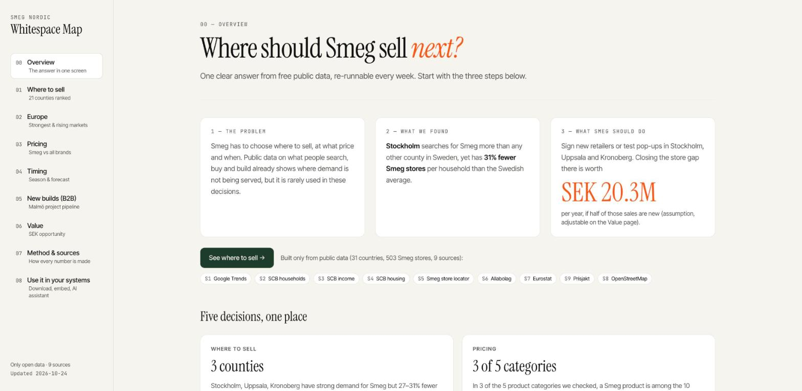
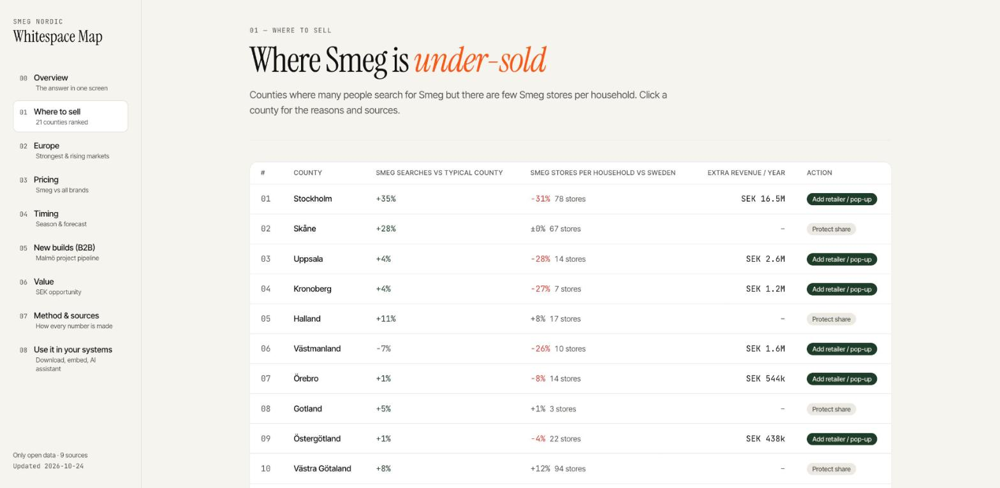
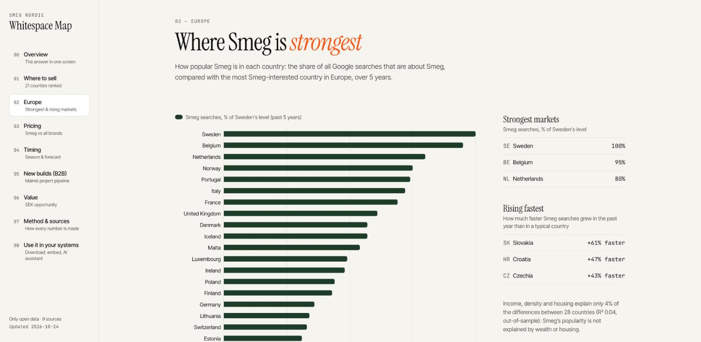
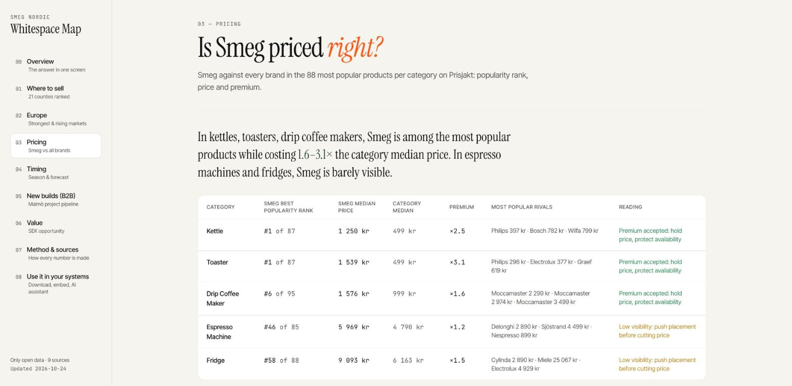
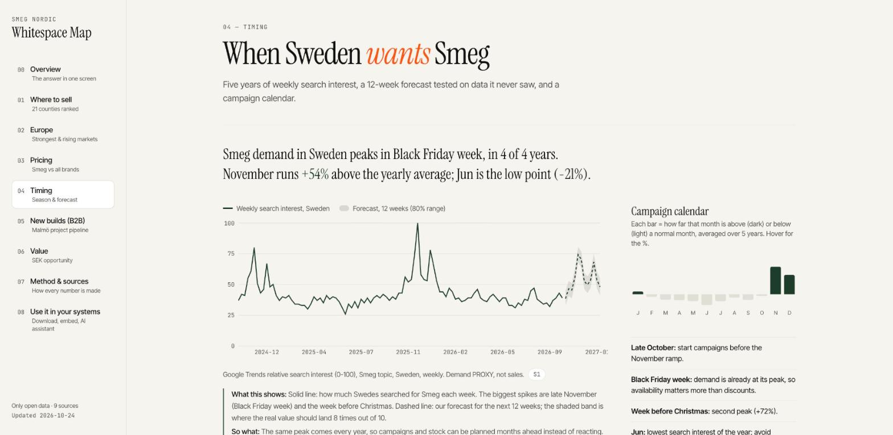
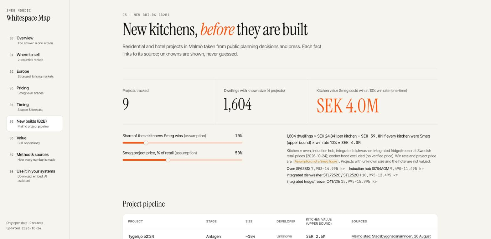
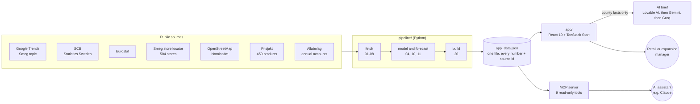
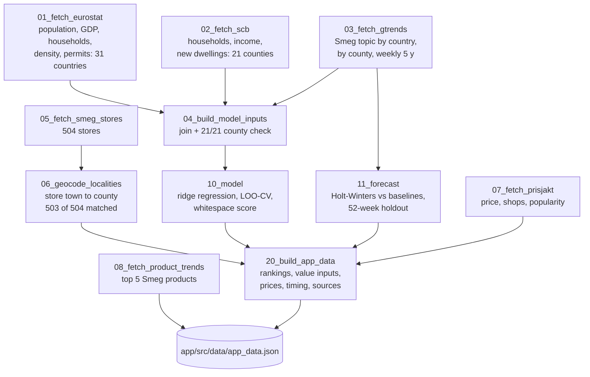
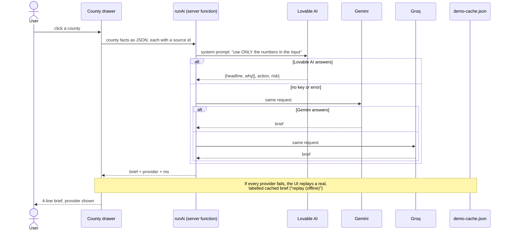
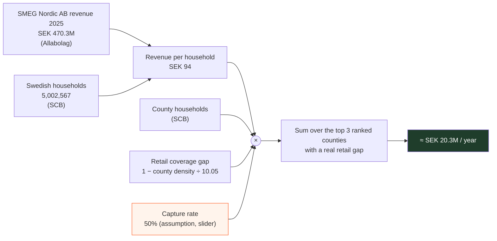

<div align="center">

# Smeg Whitespace Map

**Where should Smeg sell next, at what price, and when? Answered with nothing but open data.**

A decision tool for a premium appliance brand, built in one day at the BLING Builds hackathon (Malmö, 24 Oct 2026).<br>
Every number on screen is computed from public sources, and every number links back to its source.

[](https://github.com/Beethoven04/smeg-whitespace-map/actions/workflows/ci.yml)




</div>

> **Disclaimer.** This is an independent hackathon project. It is not affiliated with, endorsed by or built with data from Smeg S.p.A. or SMEG Nordic AB. "Smeg" is used only to name the brand being analysed. All inputs are public data.

---

## Contents

- [The challenge](#the-challenge)
- [What it finds](#what-it-finds)
- [The app, page by page](#the-app-page-by-page)
- [How it works](#how-it-works)
- [The data science](#the-data-science)
- [The money: SEK 20.3M a year](#the-money-sek-203m-a-year)
- [Quick start](#quick-start)
- [Repository layout](#repository-layout)
- [Data sources](#data-sources)
- [Honest limits](#honest-limits)
- [Credits and licence](#credits-and-licence)

---

## The challenge

> *"How can a company like Smeg make better and faster business decisions using only open data?"*
> BLING Builds hackathon use case, 24 Oct 2026

The jury judged business value, use of open data, insight, feasibility and usability, and presentation. They also required an economic value estimate with transparent assumptions.

Our answer is a whitespace map. It shows where people want Smeg but can't easily buy it, and what closing that gap is worth.

## What it finds

| Decision | Finding | Action |
|---|---|---|
| **Where to sell** | **Stockholm** has the highest Smeg search interest in Sweden (100/100), yet it has **31% fewer Smeg stores per household** than the national average (6.9 vs 10.1 per 100k households). Uppsala and Kronoberg show the same pattern. | Sign new retailers or test pop-ups there. |
| **Where to market** | Västernorrland, Västerbotten and Jönköping search **less than their size and income predict**. | Run local marketing, not new stores. |
| **How to price** | On Prisjakt, a Smeg kettle and a Smeg toaster are the **#1 most popular** products in their categories, at **2.5× and 3.1×** the category median price. In espresso machines (#46) and fridges (#58), Smeg is barely visible. | Hold the price on small appliances. Fix shelf visibility on large ones. |
| **When** | Demand peaks in **Black Friday week in 4 of 4 years**. November runs **+54%** above the yearly average, and June is the low point (−21%). | Start campaigns in late October and be fully stocked for Black Friday. |
| **B2B** | 9 Malmö housing and hotel projects from public planning documents, with **1,604 new dwellings** of known size. | Contact developers at the plan or permit stage. |
| **Europe** | Sweden, Belgium and the Netherlands lead. Slovakia, Croatia and Czechia are rising fastest. Wealth and housing explain only **4%** of the differences between countries. | Treat the risers as candidates for distributor talks or online-first tests. |

**Value:** closing the retail gap in the top 3 under-covered counties is worth **≈ SEK 20.3M per year** at a 50% capture rate. The capture rate is an assumption and can be changed with a slider. See [The money](#the-money-sek-203m-a-year).

## The app, page by page

| | |
|---|---|
| **Where to sell**: 21 counties ranked by whitespace score. Click a county to see its drivers with source ids, a recommended action and an **AI brief** that is written only from that county's facts.  | **Europe**: Smeg search interest in 31 countries, the strongest markets and the fastest risers.  |
| **Pricing**: Smeg against every brand among the ~88 most popular products in 5 Prisjakt categories.  | **Timing**: 5 years of weekly demand, a 12-week forecast with an 80% range, and a campaign calendar.  |
| **New builds (B2B)**: Malmö projects from planning decisions and press. The kitchen value uses sourced retail prices; the win-rate and price sliders are labelled assumptions.  | **Also included:** **Value** (the SEK formula with a live capture-rate slider), **Method & sources** (model against baseline, limitations, every source) and **Use it in your systems** (CSV/JSON download, an embed snippet and an MCP server for AI assistants). |

## How it works

One Python pipeline turns public sources into a single JSON file. The web app reads only that file, so no number is typed by hand into the UI.



### The pipeline

Each script writes untouched downloads to `data/raw/` and processed files to `data/clean/`. `run_all.sh` runs them in this order and copies the result into the app.



### The AI brief

The brief is a short summary written for a decision maker. It can only restate the facts it is given, and it is never the source of a number.



## The data science

### 1. Expected demand per county (awareness gaps)

- **Question:** how much should a county search for Smeg, given its size, income and new housing?
- **Model:** ridge regression on 4 features: median household income, number of households, households per person, and new dwellings per 1,000 residents. Features are standardised inside the cross-validation pipeline.
- **Fair test:** leave-one-out cross-validation. The model predicts each county without having seen it.

| Sweden, n = 21 | MAE | R² |
|---|---|---|
| Mean baseline | 7.36 | n/a |
| **Ridge (chosen)** | **6.41** (13% better) | **0.27** |

Counties far *below* their expected value are **awareness gaps**. A bootstrap shows how often each county stays in the top 5 (for example, Västerbotten 91% and Västernorrland 86.5%).

For **Europe** (n = 28), the same test explains only **4%** (R² 0.04). We say so openly and show actual interest and momentum instead of a weak prediction.

### 2. Whitespace score (store gaps)

```
whitespace = 0.5 · z(search interest) + 0.5 · z(−Smeg stores per 100k households)   → scaled 0–1
```

### 3. Seasonal forecast (timing)

The models were trained on the first 4 years of weekly data and tested on the **last 52 weeks**, which none of them saw.

| Method | MAE | MAPE |
|---|---|---|
| Same week last year (baseline) | 5.33 | 11.3% |
| Average (baseline) | 10.02 | 18.6% |
| **Holt-Winters seasonal (chosen)** | **4.09** | **8.3%** |
| STL + AR(1) | 9.11 | 20.4% |

The chosen model is 23% more accurate than "same week last year". It forecasts 12 weeks ahead with an 80% range.

Details: [`docs/MODEL.md`](docs/MODEL.md), [`docs/FORECAST.md`](docs/FORECAST.md).

## The money: SEK 20.3M a year



| County | Households | Smeg stores / 100k hh | Opportunity |
|---|---|---|---|
| Stockholm | 1,127,801 | 6.92 | SEK 16.5M |
| Uppsala | 193,944 | 7.22 | SEK 2.6M |
| Kronoberg | 95,795 | 7.31 | SEK 1.2M |
| **Total** | | national: 10.05 | **≈ SEK 20.3M / year** |

The value is computed **in the app** (`app/src/lib/value.ts`) from `app_data.json`, so the slider updates it live. The B2B pipeline is a separate, **one-time** figure (≈ SEK 4.0M at a 10% win rate) and is not added to the yearly total. Full derivation: [`docs/VALUE.md`](docs/VALUE.md).

## Quick start

### Run the app

Requires Node 22 or later (CI uses Node 22).

```bash
git clone https://github.com/Beethoven04/smeg-whitespace-map.git
cd smeg-whitespace-map/app
npm install
npm run dev          # http://localhost:8080
```

The AI brief is optional. Without keys, the Stockholm brief is replayed from a labelled cache. To generate live briefs:

```bash
cp .env.example .env.local   # add GEMINI_API_KEY and/or GROQ_API_KEY
```

Checks: `npx tsc --noEmit`, `npm run lint`, `npm test`, `npm run build`.

### Rebuild the data

```bash
cd pipeline
python3 -m venv .venv && source .venv/bin/activate
pip install -r requirements.txt

./run_all.sh --offline   # rebuild models and app_data.json from the files in the repo
./run_all.sh             # re-fetch every source first (needs network)
```

`--offline` reproduces the committed `app_data.json` exactly, apart from its timestamp. CI checks this on every push. A full run fetches the latest public data, so the analysis can be refreshed weekly.

### Ask it from an AI assistant (MCP)

```bash
cd pipeline
python3.12 -m venv mcp_server/.venv
mcp_server/.venv/bin/pip install -r mcp_server/requirements.txt
claude mcp add smeg-whitespace -- "$PWD/mcp_server/.venv/bin/python" "$PWD/mcp_server/server.py"
```

Then ask: *"Where should Smeg sign the next retailer?"* or *"What is the value at 30% capture?"*. See [`pipeline/mcp_server/README.md`](pipeline/mcp_server/README.md).

## Repository layout

```
smeg-whitespace-map/
├── app/                      Web app (React 19, TanStack Start, Tailwind 4, Recharts)
│   ├── src/routes/           One file per page: index, sweden, europe, pricing, timing,
│   │                         new-builds, value, method, integrate
│   ├── src/components/       County table and drawer, charts, AI brief, app shell
│   ├── src/lib/              value.ts (SEK formula), ai.functions.ts (provider chain),
│   │                         b2b/ (Malmö projects + sourced kitchen prices)
│   └── src/data/             app_data.json (built by the pipeline), demo-cache.json
├── pipeline/
│   ├── scripts/              01-08 fetch · 04, 10, 11 model · 20 build
│   ├── data/raw/             Official downloads (Eurostat, SCB, Google Trends, OSM)
│   ├── data/clean/           Processed tables, model outputs, app_data.json
│   ├── mcp_server/           MCP server over app_data.json
│   └── run_all.sh
└── docs/                     APP_OVERVIEW, MODEL, FORECAST, VALUE, SOURCES, AUDIT
```

**Stack:** the UI was designed in [Lovable](https://lovable.dev) and then developed in code. It uses React 19, TanStack Start and Router, Vite, Tailwind CSS 4, shadcn/ui and Recharts. The data side uses Python with pandas, scikit-learn, statsmodels and pytrends.

## Data sources

| Id | Source | Used for | Licence |
|---|---|---|---|
| S1 | Google Trends, "Smeg" topic (`/g/11cnkj_9n2`) | Demand proxy: countries, counties, weekly | Public; cite Google Trends |
| S2–S4 | SCB, Statistics Sweden (PxWeb API) | Households, income, new dwellings per county | CC0 |
| S5 | Smeg store locator (smeg.com/se) | 504 stores = retail footprint | Public web page |
| S6 | Allabolag / Bolagsverket | SMEG Nordic AB revenue 2025 | Public company data |
| S7 | Eurostat API | Country statistics | CC BY 4.0 |
| S8 | OpenStreetMap Nominatim | Store town to county | ODbL |
| S9 | Prisjakt.nu | Prices, number of shops, popularity | Public web page |
| B1–B3 | Malmö stad planning documents, press, PriceRunner, Bygghemma | B2B projects, kitchen prices | Public documents |

Every source has its URL and access time in [`docs/SOURCES.md`](docs/SOURCES.md). An independent audit, with every check and how each issue was fixed, is in [`docs/AUDIT.md`](docs/AUDIT.md).

Raw HTML pages scraped from Prisjakt and the Smeg store locator are **not redistributed** in this repo. The scripts re-fetch them, politely and with delays. Only derived tables are included.

## Honest limits

1. Google search interest is a **proxy for demand, not sales**.
2. SMEG Nordic AB revenue may include some sales outside Sweden, so the SEK value is an **upper bound**.
3. The capture rate (50%) and the B2B win rate and project price are **assumptions**. They are labelled in the UI and can be changed with sliders.
4. Prisjakt prices are **one snapshot** (24 Oct 2026).
5. Country and county search scores come from separate queries, so they **cannot be compared** with each other.
6. **Deliberately not built:**
   - Restock quantities, which need internal sales data.
   - Second-hand data from Blocket, whose terms forbid automated collection.

## Credits and licence

Built by a team of 5 at **BLING Builds** (theme: *Efficient Entrepreneurship*), Malmö, 24 Oct 2026. The B2B project research comes from the team's own reading of public Malmö planning documents.

- **Code:** [MIT](LICENSE).
- **Data:** each dataset keeps its source's own licence (see the table above). The OpenStreetMap-derived data is © OpenStreetMap contributors (ODbL).
